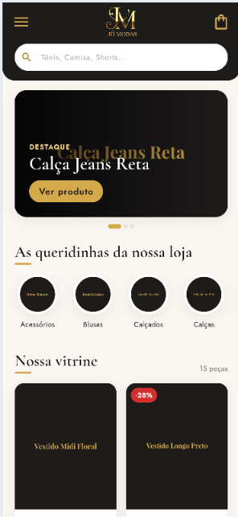
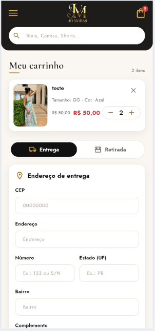
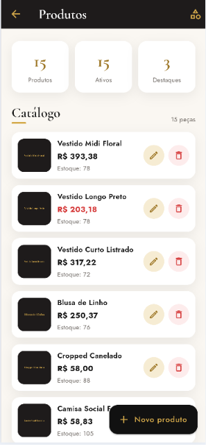
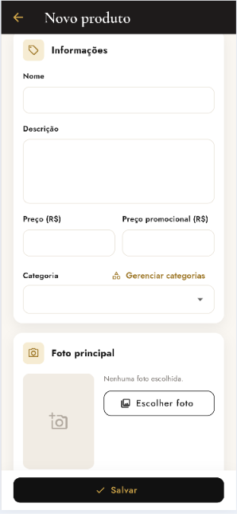
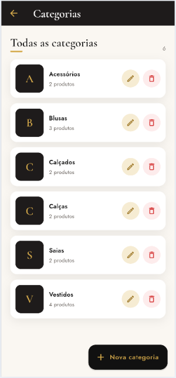
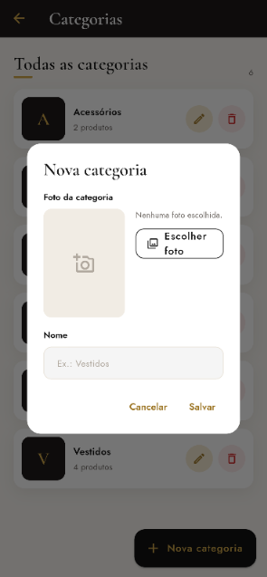

# Jô Modas

- **Aluno:** Eric Yuri Antunes Cabral
- **Back-end:** Opção A — API Laravel (Laravel + Sanctum + MySQL)

## Descrição

App da loja de roupas Jô Modas. O cliente faz login, navega pelo catálogo
(categorias, busca e preço promocional), vê os detalhes do produto, monta o
carrinho e envia o pedido por WhatsApp, com entrega (endereço pelo CEP) ou
retirada na loja.

O administrador tem CRUD completo de **produtos** (com estoque por tamanho e cor
e fotos) e de **categorias**. Todos os dados vêm da API.

## Telas e rotas

| Tela | Rota | Nome |
|---|---|---|
| Login | `/login` | `sign-in` |
| Cadastro | `/cadastro` | `sign-up` |
| Login do administrador | `/login-adm` | `admin-sign-in` |
| Cadastro de administrador | `/cadastro-adm` | `admin-sign-up` |
| Início | `/inicio` | `home` |
| Detalhes do produto | `/produto/:id` | `product` |
| Carrinho | `/carrinho` | `cart` |
| Produtos (admin) | `/admin/produtos` | `admin-products` |
| Novo produto (admin) | `/admin/produtos/novo` | `admin-product-new` |
| Editar produto (admin) | `/admin/produtos/:id/editar` | `admin-product-edit` |
| Categorias (admin) | `/admin/categorias` | `admin-categories` |

As rotas `/admin` só abrem para contas de administrador.

## Como rodar

1. Suba a API Laravel (repositório separado) com o banco populado:
   `php artisan migrate:fresh --seed`. A API fica em `http://localhost:8021/api`.
2. Neste projeto:

```bash
flutter pub get
flutter run
```

No Chrome e no emulador Android o app encontra a API sozinho. Em celular físico,
informe o IP do computador:

```bash
flutter run --dart-define=API_URL=http://IP-DO-PC:8021/api
```

Contas de teste:

| Perfil | E-mail | Senha |
|---|---|---|
| Administrador | `admin@jomodas.com` | `admin123` |
| Cliente | `cliente@jomodas.com` | `cliente123` |

O administrador entra pelo botão **Entrar como ADM**, na tela de login.

## Prints das telas

### Entrada

| Login | Cadastro | Login do administrador | Cadastro de administrador |
|---|---|---|---|
|  |  |  |  |

### Loja

| Início | Detalhes do produto | Carrinho |
|---|---|---|
|  |  |  |

### Administração

| Produtos | Cadastro de produto | Categorias | Cadastro de categoria |
|---|---|---|---|
|  |  |  |  |
